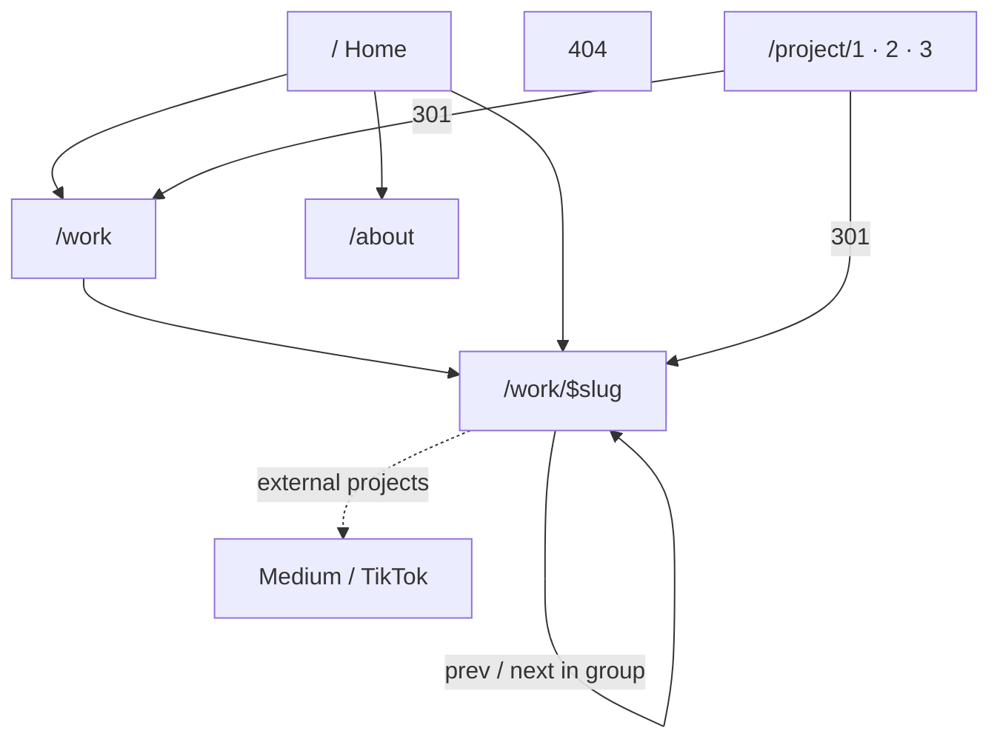

# Information architecture & sitemap (PORT-003)

Drafted 2026-10-17 from Bibi's decisions, the [content inventory](content-inventory.md) and the [brief](brief.md).

**Decisions:**
- **New case studies at launch:** momoProto, Itaú credit card fees (annuity + upgrade/downgrade), and the momoGood platform with Tatango AI. Other new work doesn't get a case study (see §5).
- **Busca Resgatados and Rato Túlio** get a short on-site page with a link to the full Medium post or TikTok video.
- **No `/notes` section at launch.** Talks are mentioned on `/about`, and Medium is linked in the footer. `/notes` stays in the parking lot.
- **`/work`** shows two groups, Work and Craft, with no filters.

## 1. Sitemap

| Route | Purpose | Sections, in order | Top task served (brief §3) |
|---|---|---|---|
| `/` | First impression + routing | Hero · Featured work (4) · "count me in for" interests · Short about · Contact CTA | Scan featured work, get in touch |
| `/work` | Every project | **Work** group, then **Craft** group, each sorted by `order` | Read a case study |
| `/work/$slug` | One project | Summary block (role, timeline, team, outcome) · body · links (live prototype, repo, external post) · prev/next in the same group · contact CTA | Read a case study, see how Bibi prototypes |
| `/about` | Background | Long bio · Experience · Education · Talks & teaching · Contact CTA | Background and facts: current role, 8+ years |
| 404 | Lost visitors | Message · links to `/` and `/work` (`noindex`) | — |

## 2. Navigation
- **Header:** logo (home link, accessible name "Bibi Branco") · **Work** `/work` · **About** `/about` · **Say hi** (scrolls to the contact CTA, which uses `mailto:oi@bibibran.co`).
- **Footer:** email `oi@bibibran.co` · LinkedIn · Medium · credit for v3 by Amanda Medeiros (F1/F2, reworded) · © year.
- Case-study pages have no sidebar. Prev/next and the header replace v3's "back to homepage" (P0).

## 3. Projects and slugs
**Slug rule:** lowercase ASCII, kebab-case, no accents (`túlio` → `tulio`, `itaú` → `itau`), no years or ids. A slug is permanent once published. If one ever has to change, add a 301 from the old slug.

| Slug | Title | Group | Featured on home | Page type | Source |
|---|---|---|---|---|---|
| `momoproto` | momoProto | work | ✅ 1 | Full case study | New (inventory §7a) |
| `momogood-platform` | momoGood platform & Tatango AI | work | ✅ 2 | Full case study | New (§7a) |
| `itau-credit-card-fees` | Itaú credit card fees | work | ✅ 3 | Full case study (annuity + upgrade/downgrade) | New (§7a) |
| `aedit` | AEDIT | work | — | Full case study | P1.3 |
| `thome` | Thomé | work | — | Full case study | P1.4 |
| `busca-resgatados` | Busca Resgatados | work | — | Short page + Medium link | LP2, LP3 |
| `rato-tulio` | Rato Túlio | craft | ✅ 4 | Short page + TikTok link | LP4, LP5 |
| `woodworking` | Woodworking | craft | — | Full case study | P2.1, P2.2 |
| `itp-mapping` | ITP Camp interaction map | craft | — | Full case study | P3.1–P3.3 |

- The **featured order** is a starting point: three recent work projects and one craft project, so the home page shows both sides. To change it, change `featured`/`order` in the MDX.
- A **short page** has the same layout as a full one, with a cover, summary block, two or three paragraphs and a prominent "Read the full story on Medium" or "Watch on TikTok" link.

## 4. Legacy redirects (input for PORT-409)
301s at the host. `/project/1` grouped several projects, so it goes to the Work group on `/work`.

| From | To | Why |
|---|---|---|
| `/project/1` | `/work#work` | v3's "product design" page (AEDIT, Thomé, other projects) |
| `/project/2` | `/work/woodworking` | v3's "crafting" page was mostly woodworking |
| `/project/3` | `/work/itp-mapping` | v3's "data viz" page was the ITP map |
| `/project/:any other` | `/work` | Catch-all for ids that never existed |

## 5. Inventory coverage
Every PORT-001 item has a home or is dropped. G = global, H/F = header/footer, HE = hero, LP = latest projects, T = timeline, P = case studies, A = about, C = contact.

| Items | New home |
|---|---|
| G1, G7 | Per-page titles and meta (PORT-008, PORT-401, PORT-501) |
| G2, G4 | **Dropped** |
| G3, G6 | Decided in PORT-004 (Syne kept; blue kept) |
| G5 | GA4 in PORT-502 |
| H1 | Header logo (§2) |
| F1, F2 | Footer credit (§2) |
| HE1, HE2 | Home hero (`copy.md`) |
| LP1 | Home "Featured work" |
| LP2–LP7 | `busca-resgatados`, `rato-tulio` (§3) |
| T1–T4, T6 | Home "count me in for", linking to `/work#work`, `/work/woodworking` and `/work/itp-mapping` |
| T5 | "sharing knowledge" stays as text in the interests list, and links to `/about#talks` |
| P0 | **Dropped** (replaced by nav + prev/next) |
| P1.1, P1.2 | Split into per-project pages. The company list moves to `/about` |
| P1.3, P1.4 | `aedit`, `thome` |
| P1.5 "other projects" | **Dropped** as a page. One line on `/about` |
| P2.x, P3.x | `woodworking`, `itp-mapping` |
| A1–A10 | `/about` (experience includes momoGood and Itaú, §7a) |
| C1–C4 | Contact CTA on `/`, `/work/$slug` and `/about` |
| §7a AI Figma → SQL plugin | No case study. A bullet in the Itaú experience entry on `/about` |
| §7a Product image tools, momoGood design system | No case study at launch. Can be mentioned inside `momoproto` / `momogood-platform`. Revisit after launch |
| §9 images | Follow their projects. `random.jpg` is dropped with P1.5. `img01`, `habla` and `woodworking2` are only used as thumbnails if PORT-005 needs them |

## 6. Open
- NDA: confirm how much detail (screens, numbers) is allowed for `itau-credit-card-fees` and `momogood-platform` before PORT-302.
- Featured order: Bibi to confirm.
